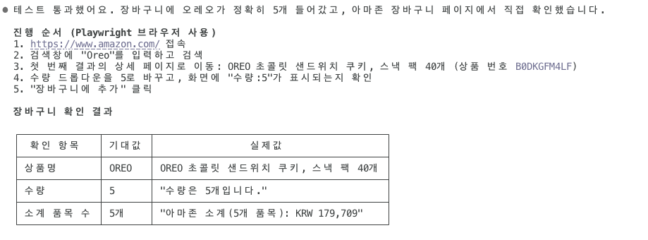
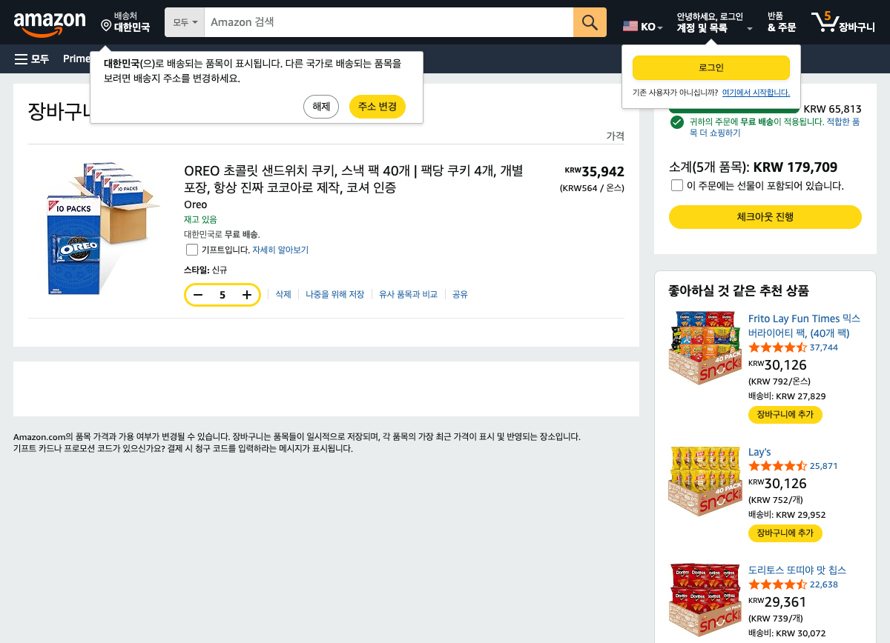

## 들어가며

요즘은 테스트가 필요하면 그냥 자연어로 AI한테 시키는 것 같다. '로그인 테스트를 해줘'라고 하면 알아서 브라우저를 띄우고 테스트를 한다.

여담으로 처음엔 playwright로 브라우저 테스트 하는 것도 너무 신기했는데 그 신비함이 익숙해진 건 아쉽다. 이제는 평범해진 그 마법이 어떻게 동작하는지 한번 뜯어보자!

장바구니 예시를 들어보자. 이렇게 프롬프트를 입력하면 곧 테스트를 완료하고 스크린샷까지 찍어서 보여준다.

> [https://www.amazon.com/](https://www.amazon.com/) 에서<br />
> 오레오 5개를 장바구니에 넣는 테스트를 해줘





이 세션에서 어떤 일이 일어났는지 살펴보자.

## 1. 사용할 툴 찾기

프롬프트를 받으면 먼저 playwright mcp 서버에서 쓸 도구를 검색하고 정한다.

```javascript
// 세션 기록의 첫 번째 tool_use
{
  "name": "ToolSearch",
  "input": {
    "query": "select:browser_navigate, browser_snapshot, browser_click, browser_type,
              browser_select_option, browser_take_screenshot, browser_wait_for, browser_press_key"
  }
}
```

## 2. 페이지 열기

`browser_navigate`로 아마존에 접속한다. 그러면 MCP 서버는 결과로 실행한 코드와 스냅샷을 저장한 파일 경로를 리턴한다.

````javascript
### Ran Playwright code
```js
await page.goto('https://www.amazon.com/');
```
### Page
- Page URL: https://www.amazon.com/
### Snapshot
- [Snapshot](.playwright-mcp/page.yml)
````

## 3. 검색창 찾기

스냅샷 파일에는 페이지가 접근성 트리 형태로 저장되어 있어 요소의 역할과 이름이 텍스트로 정리되어 있다. 여기서 `grep`으로 검색창의 ref를 찾는다.

```javascript
$ grep -nE 'searchbox|Search Amazon|captcha|Continue' page.yml
- searchbox "Amazon 검색" [ref=f1e90]
```

## 4. 검색하기

검색창 ref인 `f1e90` 에 `Oreo` 를 입력하고 엔터를 누르라고 요청한다. MCP 서버는 `f1e90` 에 대응하는 요소를 찾아 입력하고, 실행한 내용을 `getByRole` 코드로 바꿔서 리턴한다.

```javascript
// AI의 요청
{"target": "f1e90", "text": "Oreo", "submit": true, "element": "Amazon search box"}

// MCP 서버 응답 일부
await page.getByRole('searchbox', { name: 'Amazon 검색' }).fill('Oreo');
await page.getByRole('searchbox', { name: 'Amazon 검색' }).press('Enter');
```

Chrome DevTools Protocol(CDP) 로그를 확인해보면 "Oreo"를 한 글자씩 치지 않고 한 번에 붙여넣는다. 키 이벤트는 Enter에만 사용했다.

```javascript
{"method":"Input.insertText","params":{"text":"Oreo"}}
{"method":"Input.dispatchKeyEvent","params":{"type":"keyDown","key":"Enter",...}}
{"method":"Input.dispatchKeyEvent","params":{"type":"keyUp","key":"Enter",...}}
```

## 5. 상품 고르기

검색 결과 페이지에서 장바구니에 담기 위해 장바구니 버튼을 스냅샷에서 검색한다. 현재 페이지에 여러 상품들이 있어 장바구니 버튼이 많다.

```txt
237: - button "장바구니에 추가" [ref=f4e269]
281: - button "장바구니에 추가" [ref=f4e351]
324: - button "장바구니에 추가" [ref=f4e421]
367: - button "장바구니에 추가" [ref=f4e491]
414: - button "장바구니에 추가" [ref=f4e568]
450: - button "장바구니에 추가" [ref=f4e630]
// ...
```

그래서 그중에 가장 첫 번째 상품 스냅샷을 읽는다.

```txt
- heading "스폰서 광고 - OREO 초콜릿 샌드위치 쿠키, 스낵 팩 40개" [level=2]
- button "별 5개 중 4.8, 등급 세부 정보"
- link "KRW 36,158 ( KRW 568 /온스)"
- button "장바구니에 추가" [ref=f4e269]수량 선택
```

수량을 선택할 수 있게 상품 번호를 읽고 상세 페이지로 이동한다.

## 6. 수량 선택하기

상세 페이지의 스냅샷을 보고 수량을 선택할 수 있는 `combobox` ref 값을 가져온다.

```javascript
- generic [aria-hidden] [ref=f9e325]: "수량:"
- combobox "수량:" [ref=f9e326]:
  - option "1" [selected]
  - option "2"
  # ... option "3" ~ "10"
- generic [aria-hidden] [ref=f9e329] [cursor=pointer]: 수량:1
```

그리고 마우스 이벤트 없이 코드를 이용해 `combobox` 값을 5로 고른다.

```txt
// 실행 후 다시 확인한 스냅샷
- generic [aria-hidden] [ref=f9e329] [cursor=pointer]: 수량:5
```

## 7. 장바구니 담기

**모델 → Claude Code**

스냅샷에서 찾은 장바구니 담기 버튼 `ref`를 target에 넣는다.

```txt
{
  "type": "tool_use",
  "name": "mcp__playwright__browser_click",
  "input": { "target": "f9e337", "element": "Add to cart button" }
}
```

**Claude Code → MCP 서버**

MCP 표준 형식인 `tools/call` 로 MCP 서버에 요청을 보낸다. 그러면 MCP 서버는 응답으로 Playwright 코드, 페이지 URL, 스냅샷 파일 경로를 돌려준다.

```txt
// Request
{"jsonrpc":"2.0","id":12,"method":"tools/call",
   "params":{"name":"browser_click","arguments":{"element":"Add to cart button","target":"f9e337"}}}

// Response
{"jsonrpc":"2.0","id":12,"result":{"content":[{"type":"text","text":"### Ran Playwright code ..."}]}}
```

**MCP 서버 → Playwright**

서버는 `ref` 로 버튼을 찾아 `click()`을 실행한다.

```javascript
await page.getByRole('button', { name: '장바구니에 추가', description: '장바구니에 추가' }).click();
```

**Playwright → Chrome**

Playwright는 버튼을 바로 클릭하지 않고 클릭이 먼저 가능한지 확인한다. 그 후 계산한 좌표(x:1140 y:533)로 마우스를 조작한다.

```txt
// cdp log
.871  Runtime.callFunctionOn                    # 보이는지, 활성 상태인지 확인
.900  DOM.scrollIntoViewIfNeeded                # 화면 안으로 스크롤
.900  DOM.getContentQuads                       # 버튼의 화면 좌표 계산
.901  Runtime.callFunctionOn ×2                 # 다른 요소에 가려졌는지 확인
.902  Input.dispatchMouseEvent  mouseMoved     x:1140 y:533
.902  Input.dispatchMouseEvent  mousePressed   button:left
.902  Input.dispatchMouseEvent  mouseReleased  button:left
```

## 8. 확인하기

마지막으로 장바구니 페이지로 이동해 수량이 5개가 맞는지 확인한다.

```txt
- heading "아마존 소계(5개 품목): KRW 179,709" [level=3]
- heading "OREO 초콜릿 샌드위치 쿠키, 스낵 팩 40개 | ..." [level=3]
- group "수량은 5개입니다."
```

## 추가로 알게 된 점

**스냅샷을 찍는 시점**

Playwright MCP가 도구(navigate, click 등)를 실행할 때마다 조작이 끝난 직후 자동으로 스냅샷을 찍는다. 이때, 페이지가 아직 그려지는 중이라면 스냅샷이 비거나 덜 채워질 수도 있다.

**어떤 기준으로 마우스로 클릭할까?**

AI는 사람 같은 플로우대로 테스트를 진행하지 않는 것 같다. 상품 상세 페이지로 이동할 때는 url로 직접 이동하고 장바구니를 담을 때에는 마우스로 클릭을 한다. 그 기준은 AI가 Playwright MCP의 어떤 도구를 선택하느냐에 따라 달라진다.

`browser_navigate` 는 주소창에 URL을 넣는 것처럼 바로 이동하고, `browser_click` 은 마우스 이벤트가 발생한다. 그래서 직접 사람이 테스트하는 것처럼 하려면 방법을 지시해야 한다.

---

이 글은 AI의 자료 조사 도움을 받아 작성한 글입니다